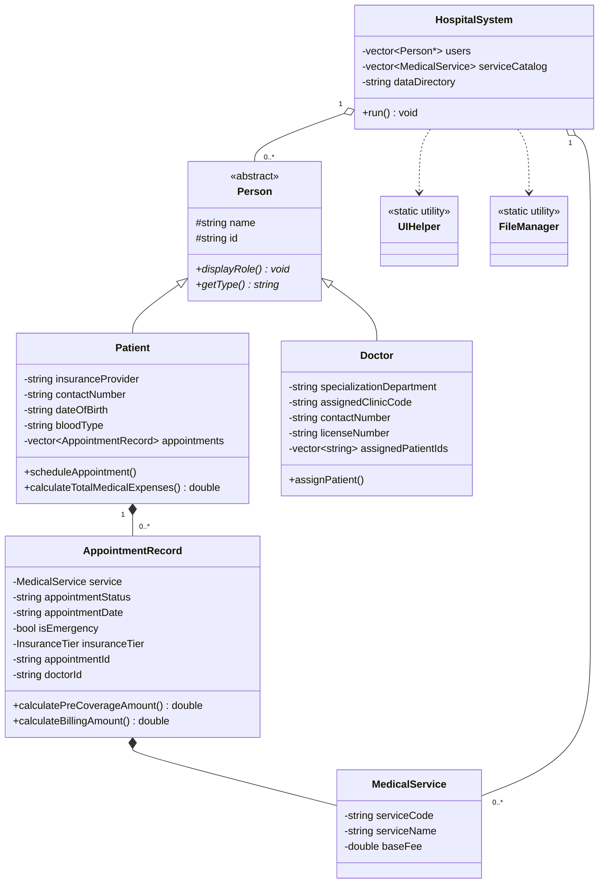
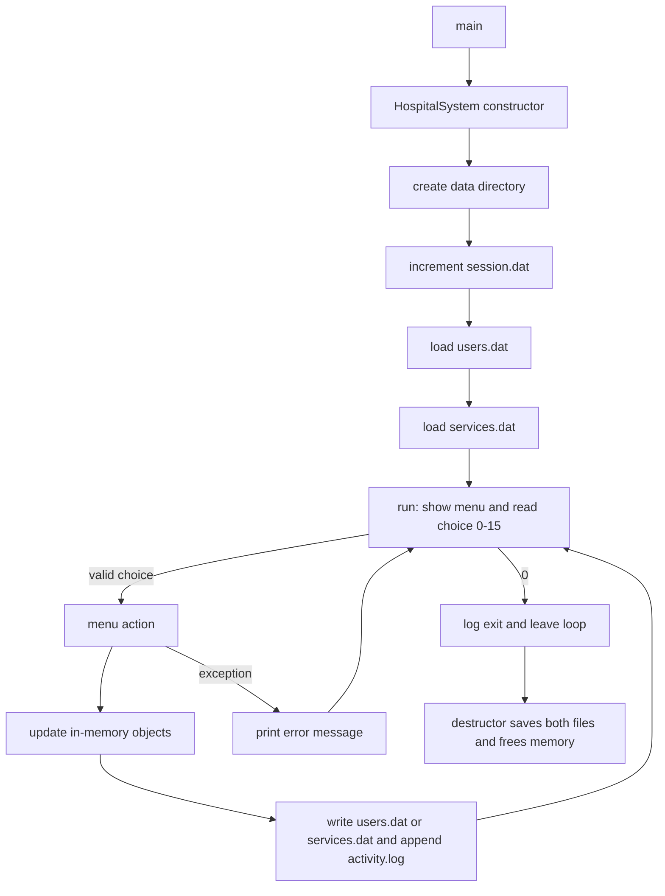

# Hospital Management System

A console-based hospital administration program written in C++. It lets staff register patients and doctors, maintain a catalog of medical services, schedule appointments, apply insurance tiers to bills, and review billing and system statistics. All data is saved to plain-text files, so no database or external service is required.

The project is also a compact demonstration of object-oriented C++: an abstract base class with runtime polymorphism, inheritance, static members, exceptions, and file persistence.

## Table of Contents

- [Overview](#overview)
- [Features](#features)
- [Technology Stack](#technology-stack)
- [System Architecture](#system-architecture)
- [Repository Structure](#repository-structure)
- [Prerequisites](#prerequisites)
- [Installation and Setup](#installation-and-setup)
- [Configuration](#configuration)
- [How to Run](#how-to-run)
- [Usage Guide](#usage-guide)
- [Billing Rules](#billing-rules)
- [Data Storage](#data-storage)
- [Testing](#testing)
- [Deployment](#deployment)
- [Troubleshooting](#troubleshooting)
- [Security and Known Limitations](#security-and-known-limitations)
- [Future Improvements](#future-improvements)
- [Contributing](#contributing)

## Overview

**Problem it addresses:** small clinics and coursework scenarios need a simple way to keep track of who the patients and doctors are, which services are offered, which appointments exist, and what each patient owes after insurance. This program provides that through a numbered text menu.

**Intended users:** hospital or clinic front-desk staff in a demo or learning context, and students studying object-oriented programming in C++.

**What it is not:** it has no network interface, no user login, and no database. It is a single-user, single-process terminal application.

## Features

| # | Menu option | What it does |
|---|-------------|--------------|
| 1 | Add New Patient | Prompts for name, insurance provider, contact number, date of birth, and blood type. Generates an ID of the form `PAT0001`. Only the name is mandatory; other fields fall back to `None`, `N/A`, `TBD`, or `Unknown`. |
| 2 | Add New Doctor | Prompts for name, specialization, clinic code, contact number, and license number. Generates an ID of the form `DOC0001`. Defaults: `General Medicine`, `UNASSIGNED`, `N/A`. |
| 3 | Add New Medical Service | Prompts for a service name and base fee (default `$50.00`, or any value from 0 to 99999.99). Generates a code of the form `SVC001`. |
| 4 | Schedule Appointment | Books a service for a patient on a date (`YYYY-MM-DD`, or blank for `TBD`), flags it as emergency or not, and optionally assigns a doctor. Prevents a second *Scheduled* appointment for the same service for the same patient. |
| 5 | Set Appointment Status / Bill Modifier | Changes an appointment's status (`Scheduled`, `Completed`, `Cancelled`) and/or its insurance tier (`NONE`, `BASIC`, `PLUS`, `ELITE`). |
| 6 | View All Users | Lists every patient and doctor by calling the virtual `displayRole()` on each `Person`. |
| 7 | View Medical Services Catalog | Tabulates all services with code, name, and base fee. |
| 8 | Search User by ID | Shows one patient or doctor. For a doctor it also lists the appointments assigned to them. |
| 9 | View Patient Billing Summary | Prints per-appointment amounts before and after insurance plus totals. |
| 10 | System Statistics | Counts of patients, doctors, services, appointments by status, projected revenue, and the session number. |
| 11 | Edit Records | Edits a patient, doctor, or service. Pressing Enter keeps the current value. |
| 12 | Delete Records | Deletes a patient, doctor, or service after a yes/no confirmation. |
| 13 | View All Patients | Lists all patients with their appointment tables. |
| 14 | View All Doctors | Lists all doctors. |
| 15 | View All Appointments | Lists all appointments across patients, grouped by status (Scheduled, Completed, Cancelled). Within each group, dated entries are sorted newest first and `TBD`/`N/A` dates come last. |
| 0 | Exit System | Saves and quits. |

Other behavior worth knowing:

- Every change is written to disk immediately, and again when the program exits.
- Each significant action is appended to a timestamped activity log.
- Input is validated: menu numbers are range-checked, dates must be real calendar dates between 1900 and 2100 (leap years handled), and fees must be numeric and within range.
- Errors inside a menu action are caught in the main loop and shown as `[ERROR]` messages rather than crashing the program.

## Technology Stack

| Technology | Purpose |
|------------|---------|
| C++ (verified to build with `-std=c++17`) | Implementation language |
| C++ Standard Library only (`<string>`, `<vector>`, `<map>`, `<functional>`, `<fstream>`, `<sstream>`, `<iomanip>`, `<algorithm>`, `<ctime>`, `<stdexcept>`) | Containers, I/O, formatting, exceptions |
| `<sys/stat.h>` and `<direct.h>` (Windows only) | Checking for files and creating the data directory |
| Plain text files (`|`-delimited) | Persistence |

There are no third-party libraries, package managers, or build-system files (no Makefile or CMake) in the repository.

## System Architecture

The program is a layered console application. `main()` creates a single `HospitalSystem` object, which owns all in-memory data and drives the menu loop. Domain classes hold the business rules; two helper classes handle terminal output and file access.



### Components

| Component | Responsibility |
|-----------|----------------|
| `main.cpp` | Creates `HospitalSystem("data")`, calls `run()`, and converts uncaught exceptions into an exit code (1 for `std::exception`, 2 for anything else). |
| `HospitalSystem` | Owns the lists of users (as `Person*`) and services; implements every menu action; loads data in its constructor and saves in its destructor; keeps ID counters consistent. |
| `Person` | Abstract base with `name` and `id`; declares pure virtual `displayRole()` and `getType()`. |
| `Patient` | Patient details plus a list of `AppointmentRecord`s; computes totals. |
| `Doctor` | Doctor details plus the IDs of patients assigned to them. |
| `AppointmentRecord` | One booking: a copy of the service, status, date, emergency flag, insurance tier, doctor ID, and an auto-generated `APT#####` ID. Contains the billing arithmetic. |
| `MedicalService` | Catalog item: code, name, base fee. |
| `UIHelper` | Static helpers for banners, tables, status lines (`[SUCCESS]`, `[ERROR]`, ...), validated input, currency formatting, and date validation. |
| `FileManager` | Static helpers for file existence, directory creation, read/write/append, deletion, timestamps, and activity logging. |

### Application flow



### Design decisions visible in the code

- **Polymorphic user list.** Patients and doctors share one `vector<Person*>`; option 6 demonstrates runtime polymorphism by calling `displayRole()` through the base pointer.
- **Appointments store a copy of the service.** An appointment keeps its own copy of the service code, name, and fee, so editing or deleting a catalog entry later does not change existing appointments or their bills.
- **Gap-filling IDs.** When a patient, doctor, or service is added or deleted, `recalculateIdCounters()` sets the next number to the smallest unused one, so deleted IDs can be reused.
- **Save on every change.** Data is flushed after each add, edit, delete, schedule, and status change, and once more on exit.

## Repository Structure

```text
Hospital-Management-System/
├── main.cpp                # Entry point
├── HospitalSystem.h/.cpp   # Menu loop, business workflows, load/save logic
├── Person.h/.cpp           # Abstract base class
├── Patient.h/.cpp          # Patient entity and expense totals
├── Doctor.h/.cpp           # Doctor entity and patient assignments
├── AppointmentRecord.h/.cpp# Appointment entity, insurance tiers, billing math
├── MedicalService.h/.cpp   # Service catalog item
├── UIHelper.h/.cpp         # Console formatting and validated input
├── FileManager.h/.cpp      # File and logging utilities
├── hospital_app.exe        # Pre-built executable committed to the repository
├── README.txt              # Existing placeholder (empty); superseded by this README.md
└── .gitignore              # Ignores the four runtime files under data/
```

The `data/` directory is **not** in the repository. It is created automatically in the current working directory the first time the program runs.

`hospital_app.exe` has the `MZ` header of a Windows executable. It was not verified here that it matches the current source, so rebuild from source if in doubt.

## Prerequisites

- A C++ compiler with C++11 or newer support. The code was verified to compile with **g++ 13.3 using `-std=c++17 -Wall -Wextra`**, with no warnings.
- A terminal. On Linux/macOS the program calls `clear` to redraw the screen, so a normal `TERM` setting is needed; on Windows it calls `cls`.
- Git, to clone the repository.

No accounts, databases, or network access are needed.

## Installation and Setup

1. **Clone the repository**

   ```bash
   git clone https://github.com/vanessaserenina/Hospital-Management-System.git
   ```

2. **Enter the project directory**

   ```bash
   cd Hospital-Management-System
   ```

3. **Compile** (there is no build file, so compile all `.cpp` files together)

   Linux / macOS / MinGW / WSL:

   ```bash
   g++ -std=c++17 -Wall -Wextra -o hospital_app *.cpp
   ```

   On Windows with MinGW, name the output `hospital_app.exe` to match the committed binary. With another compiler (for example MSVC or clang), compile the same set of `.cpp` files with your usual C++17 flags; those compilers were not tested here.

There is no virtual environment, dependency install, database setup, or initialization script.

## Configuration

The program has **no environment variables and no configuration files**. The only setting is the data directory, which is hard-coded in `main.cpp` as the relative path `data`:

```cpp
HospitalSystem system("data");
```

Consequences:

- Data is read from and written to `./data/` relative to where you launch the program, not relative to the executable. Launching from a different folder starts with a different (possibly empty) data set.
- To change the location, edit that string in `main.cpp` and recompile. The directory is created one level deep only, so parent folders must already exist.

## How to Run

From the project directory:

```bash
./hospital_app          # Linux / macOS / WSL
hospital_app.exe        # Windows
```

The screen clears and the main menu appears:

```text
============================================================
              HOSPITAL MANAGEMENT SYSTEM MENU
============================================================
  1.  Add New Patient
  ...
  0.  Exit System
```

Type a number from 0 to 15 and press Enter. Choose **0** to exit so the final save and the "System exited normally" log line are written.

## Usage Guide

The menu expects a sensible order, because appointments depend on the other records:

1. **Add a service** (option 3). Scheduling is blocked with a warning until at least one service exists.
2. **Add a patient** (option 1). Note the generated ID, for example `PAT0001`.
3. **Add a doctor** (option 2, optional). Note the ID, for example `DOC0001`.
4. **Schedule an appointment** (option 4). Enter the patient ID, a service code such as `SVC001`, a date, whether it is an emergency, and optionally a doctor ID. The screen shows an estimated bill *before insurance*; new appointments always start with insurance tier `NONE`.
5. **Set the status or insurance tier** (option 5). Enter the patient ID, then the appointment ID (shown in the table, format `APT#####`), and choose to change the status, the tier, or both.
6. **Check the bill** (option 9) for the patient.

Example session (abbreviated; the text after each prompt is what the user types):

```text
Enter choice: 3
  Enter Service Name          : Checkup
  Auto-generated Service Code: SVC001
  Use default base fee ($50.00)? (y/n): y

Enter choice: 1
  Enter Patient Name          : Alice
  Auto-generated Patient ID: PAT0001
  ...

Enter choice: 4
  Enter Patient ID (PAT####): PAT0001
  Enter Service Code (SVC###) to schedule: SVC001
  Enter Appointment Date (YYYY-MM-DD): 2026-11-01
  Is this an emergency appointment? (y/n): n

Enter choice: 5      # choose Appointment APT00001, set tier to PLUS (70% coverage)

Enter choice: 9
  TOTAL BEFORE INSURANCE:        $50.00
  TOTAL DUE (AFTER INSURANCE):   $15.00
```

The amounts above come from a scripted test run of this exact flow (status set to Completed, tier PLUS).

### Input conventions

| Field | Format |
|-------|--------|
| Patient ID | `PAT` + 4 digits, e.g. `PAT0001` |
| Doctor ID | `DOC` + 4 digits, e.g. `DOC0001` |
| Service code | `SVC` + 3 digits, e.g. `SVC001` |
| Appointment ID | `APT` + 5 digits, e.g. `APT00001` |
| Dates | `YYYY-MM-DD`; blank means `TBD` where allowed |
| Yes/no prompts | Starts with `y` or `n` (case-insensitive) |

IDs are case-sensitive when searched.

## Billing Rules

Implemented in `AppointmentRecord`:

1. Start from the service's base fee.
2. If the appointment is an emergency, multiply by **1.5**.
3. A **Cancelled** appointment costs **$0.00** before insurance.
4. Apply the insurance tier's coverage; the patient owes `amount × (1 − coverage)`.

| Tier | Coverage | Patient pays |
|------|----------|--------------|
| `NONE` | 0% | 100% |
| `BASIC` | 50% | 50% |
| `PLUS` | 70% | 30% |
| `ELITE` | 100% | 0% |

Legacy tier names `PREMIUM` and `STANDARD` found in saved files are read as `ELITE` and `PLUS` respectively. The statistics screen's "Total Projected Revenue" sums the **before-insurance** amounts of all non-cancelled appointments.

## Data Storage

Data lives in `data/` and uses `|` as the field separator. These four files are listed in `.gitignore`, so they are not committed.

| File | Contents |
|------|----------|
| `users.dat` | One line per record. `PATIENT`, `APPOINTMENT` (belongs to the patient above it), and `DOCTOR` lines. |
| `services.dat` | One line per service: `code|name|baseFee`. |
| `session.dat` | A single integer that is incremented each time the program starts. |
| `activity.log` | Append-only text log with `[YYYY-MM-DD HH:MM:SS]` timestamps. |

Record layouts (taken from `saveUsersToFile()`):

```text
PATIENT|id|name|insuranceProvider|contactNumber|dateOfBirth|bloodType
APPOINTMENT|patientId|serviceCode|serviceName|baseFee|status|date|emergency(0/1)|tier|doctorId
DOCTOR|id|name|specialization|clinicCode|contactNumber|licenseNumber[|assignedPatientId...]
```

Real-looking sample from a test run:

```text
PATIENT|PAT0001|Alice|Acme|0123|1990-05-01|O+
APPOINTMENT|PAT0001|SVC001|Checkup|50|Completed|2026-11-01|0|PLUS|DOC0001
DOCTOR|DOC0001|Dr Bob|Cardio|C1|999|L1|PAT0001
```

Loading behavior: lines that cannot be parsed are skipped with a `[LOAD WARNING]` message. To start fresh, delete the `data/` folder (or its files) while the program is not running.

> **Privacy note:** these files hold names, contact numbers, dates of birth, and blood types in plain text. Do not commit or share real patient data.

## Testing

The repository contains **no automated tests, test framework, or CI configuration**, and no evaluation metrics, so none are reported here.

A manual smoke test that was run against the current code:

1. Build with the command in [Installation and Setup](#installation-and-setup) (compiled with no warnings).
2. Run from an empty folder, add a service, a patient, and a doctor, schedule an appointment, set its status and tier, view the bill, and exit with `0`.
3. Confirm that `data/` contains `users.dat`, `services.dat`, `session.dat`, and `activity.log`, and that the bill matches the [billing rules](#billing-rules).

## Deployment

No deployment configuration exists (no Docker, installer, or CI/CD files). To distribute the program, compile it and share the executable; users run it locally and get their own `data/` folder.

## Troubleshooting

| Symptom | Likely cause and fix |
|---------|----------------------|
| `g++: command not found` | Install a compiler (for example `sudo apt install g++` on Ubuntu/Debian) or use another C++ compiler. |
| Undefined reference errors at link time | Not all source files were compiled. Use `*.cpp`, not just `main.cpp`. |
| Screen does not clear, or `TERM environment variable not set` | The program runs `clear` (Linux/macOS). Run it in a normal terminal or set `TERM`, e.g. `TERM=xterm ./hospital_app`. |
| My records disappeared | The program reads `./data/` relative to the current directory. Run it from the same folder as before. |
| `[FATAL ERROR]` on start | An exception escaped `HospitalSystem` construction. Check that the working directory is writable. |
| `Patient with ID '...' not found` | IDs are case-sensitive and must include the prefix and zero padding, e.g. `PAT0001`. |
| `Patient already has an active scheduled appointment for this service` | Mark the existing appointment `Completed` or `Cancelled` (option 5) first. |
| Program seems stuck when input is piped from a file | Yes/no and number prompts re-ask until they get valid input, so redirected input that ends early can leave the program looping. Use `timeout`, and make sure scripted input covers every prompt. |
| `[LOAD WARNING] Skipping corrupted record` | A line in `users.dat` or `services.dat` could not be parsed (often a hand edit). Fix or remove that line. |

## Security and Known Limitations

Verified from the source:

- Input values are validated for type and range (menu choices, dates, fees), and invalid input produces an error message instead of a crash.
- Deleting patients, doctors, and services requires a yes/no confirmation.
- No credentials, keys, or environment secrets are used or stored.

Limitations observed in the code:

- **No authentication or access control.** Anyone who can run the program can read, change, or delete all records.
- **Plain-text, unencrypted storage** of personal data in `data/`.
- **The `|` character is not escaped.** Entering a pipe in a name or other text field would split the record incorrectly when the file is reloaded.
- **Appointment IDs are not saved.** `APT#####` numbers are reassigned from load order on each start, so the same appointment can have a different ID in the next session (for example after an earlier patient is deleted).
- **No referential cleanup for doctors and services.** Deleting a doctor leaves their ID on existing appointments (the name then shows blank). Deleting a service leaves existing appointments, which keep their own copy of it.
- **Deleting a patient** removes them from doctors' assigned-patient lists but also discards all of their appointments.
- **Doctor assignment is set only at scheduling time.** `Patient::setAppointmentDoctor` exists in the code but no menu option calls it.
- **Sequential lookups.** Records are found by linear search, which is fine for small data sets but not designed for large ones.
- **Single user, single process.** Running two copies against the same `data/` folder can overwrite each other's changes.
- **Hard-coded currency symbol (`$`)** and no taxes, discounts, or payment tracking.
- **No time or conflict checking.** Appointments have only a date, and double-booking a doctor is not prevented.

## Future Improvements

These are suggestions, not existing features:

- Add a `Makefile` or `CMakeLists.txt` so the build is one command.
- Add unit tests (for billing math, date validation, and file round-trips) and run them in CI.
- Escape or quote field values, or switch to JSON or SQLite, to remove the `|` limitation and enable safer storage.
- Persist appointment IDs and make them stable.
- Add role-based login and encrypt sensitive fields.
- Allow changing an appointment's doctor and date from the menu, and detect doctor double-booking.
- Add search and filter by name, date, or status.
- Make the data directory configurable through a command-line argument or environment variable.
- Replace the committed `.exe` with release artifacts, and add a license file (none is present).

## Contributing

1. Fork the repository and create a branch: `git checkout -b feature/short-description`.
2. Make your change and rebuild with `g++ -std=c++17 -Wall -Wextra -o hospital_app *.cpp`; keep the build free of warnings.
3. Run through the manual smoke test above, using a scratch folder so your own `data/` is not affected.
4. Commit with a clear message and open a pull request describing what changed and how you tested it.

## License

No license file is present in the repository. Add one before encouraging reuse.
